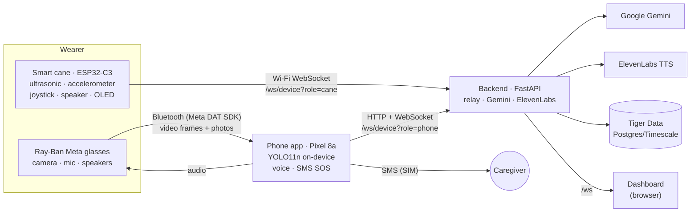
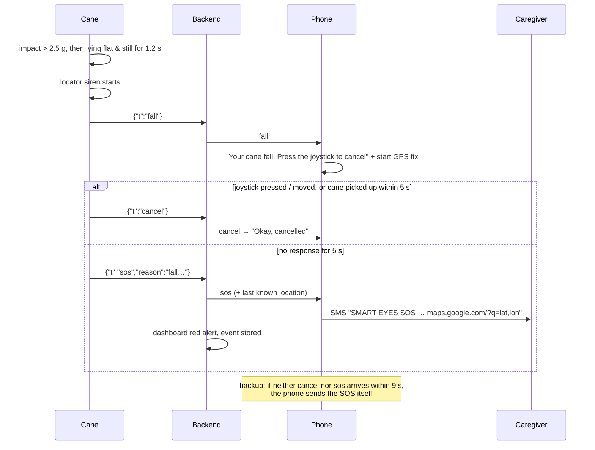

# Smart Eyes

Ray-Ban Meta glasses + a smart cane for blind and low-vision users.
**The glasses see and speak. The cane feels, warns and controls.**

- The cane beeps faster as you approach an obstacle and detects falls. It works on its own, even offline.
- The phone runs object detection (YOLO) on the glasses' camera and calls out what's around you every few seconds.
- A joystick on the cane asks Gemini to describe the scene, read text or answer a spoken question. The answer is read aloud by ElevenLabs through the glasses.
- If the cane falls and nobody responds, or you hold the button, the phone texts a caregiver your GPS location.

> Status (7 Nov 2026): the whole chain works on real hardware. Pixel 8a + Ray-Ban Meta + ESP32-C3 cane + backend with Gemini, ElevenLabs and Tiger Data. See [Status](#status).

---

## Architecture



### The four parts

| Part | Runs on | Job | Works offline? |
|---|---|---|---|
| **Cane** (`firmware/smart_cane`) | ESP32-C3 SuperMini | Distance beeps, fall detection, joystick commands, OLED status, locator siren | **Yes.** Beeps and fall siren need no network |
| **Phone app** (`android/`) | Pixel 8a, Kotlin + Compose | Glasses camera (Meta Wearables DAT 1.0.1), YOLO11n via ONNX Runtime, voice output, voice questions, SMS SOS with GPS | YOLO warnings yes; Gemini no |
| **Backend** (`backend/`) | Laptop or a Vultr VM, Python FastAPI | Relays cane ⇄ phone messages, calls Gemini/ElevenLabs (API keys never live on the phone), stores events, serves the dashboard | – |
| **Dashboard** (`dashboard/`) | Any browser at `http://<backend>:8000/` | Live distance, SOS banner with map link, latency stats, event log | – |

### Key design decisions
- **One Bluetooth link on the phone.** The glasses' camera stream needs the phone's Bluetooth. The cane uses **Wi-Fi to the backend** instead, so the two never compete. The backend relays between cane and phone over WebSockets.
- **The cane is self-sufficient.** Obstacle beeps and the fall siren are computed on the ESP32 itself. If Wi-Fi, the phone or the backend dies, the cane still protects the user.
- **YOLO always, Gemini on request.** YOLO runs on the phone for every frame (fast, free, offline) and announces every 5–10 s. Gemini (slow, costs money, needs internet) runs only when the user presses the joystick.
- **Keys stay on the server.** The phone talks only to our backend. Gemini, ElevenLabs and database credentials live in `backend/.env`.
- **Graceful degradation everywhere:**
  - No Gemini key: canned answers.
  - Model busy: automatic fallback model.
  - No ElevenLabs: the phone's built-in voice.
  - No database: local SQLite.
  - Cane offline mid-fall: the phone sends the SOS itself.

### What happens when…

| Trigger | Path | Needs internet |
|---|---|---|
| Obstacle within 60 cm of the cane | ESP32 → speaker beeps faster and higher as it gets closer; solid tone under 15 cm | No |
| Camera sees something | Glasses → phone → YOLO → every 5–10 s: "Chair ahead, close. Two people on your left." | No |
| Something big right ahead or at head height | Same path, instant: "Person right ahead, step left" + cane beeps | No |
| Joystick **press** | Cane → backend → phone → photo → backend → Gemini → ElevenLabs → glasses | Yes |
| Joystick **up** | Same, but a full-resolution photo + "read the text" prompt | Yes |
| Joystick **down** | Phone listens to a question: "where's my backpack?" (YOLO memory log), "what's that star?" (Sky Mode), or anything about the scene | Yes |
| Joystick **left / right** | Repeat the last sentence / YOLO announcements on-off | – |
| Hold the press **3 s** | SOS: SMS with a Google Maps link + dashboard alert + cane siren | SMS needs cell signal |
| **Cane falls** | See the sequence below | SMS needs cell signal |



### On-phone vision pipeline
1. **Glasses frames:**
   - Raw I420 frames arrive over Bluetooth through the Meta DAT SDK, capped at 10 fps.
   - They're converted straight to RGB at ≤960 px, without the slow JPEG round trip of an earlier version.
2. **YOLO11n (ONNX Runtime):**
   - The model accepts any input shape. Each frame keeps its aspect ratio (letterbox, long side 416), so a portrait frame runs at 256×416.
   - At startup the app times the plain CPU engine against XNNPACK and keeps the faster one. On the Pixel 8a that's **CPU, about 29 ms per inference** (XNNPACK: 55 ms).
3. **HazardEngine:**
   - Keeps the last 1.5 s of detections. An object must appear in at least 2 frames, which stops one-frame ghosts, and one missed frame doesn't drop it.
   - Decides between an urgent warning and the periodic summary.
4. **Memory log:** every 10 s the labels (never images) go to the backend, so "where's my backpack?" can be answered later.

`tools/verify_yolo_decode.py` runs the same decode in Python and checks it against Ultralytics' own predictor.

YOLO11n knows the 80 COCO classes (people, vehicles, furniture, bags, bottles…). It **does not** know doors, stairs, curbs or poles; the cane's ultrasonic sensor and Gemini (joystick press) cover those.

### Gemini on the backend
- Structured JSON output: one sentence, a hazard level and an object list. Prompts per mode: `describe`, `read`, `ask`, `scan`.
- **Model fallback chain:** `GEMINI_MODEL` → `GEMINI_FALLBACK_MODELS`, on 404/429/5xx/timeouts.
- Timeouts: 7 s per model, 13 s total, which stays under the phone's 15 s limit.
- Models that reject the "thinking off" setting are retried without it.
- `/health` shows which model answered last.

---

## Repository layout

| Path | What |
|---|---|
| `android/` | Kotlin app. `SmartEyesController.kt` is the brain; `glasses/` (DAT camera, phone-camera fallback), `vision/` (YOLO, frame conversion, HazardEngine), `cane/CaneLink.kt` (WebSocket), `sos/SosSender.kt`, `audio/` (voice out/in), `net/Backend.kt` |
| `backend/app/` | FastAPI: `main.py` (routes + `/ws/device` relay), `gemini.py`, `tts.py`, `db.py`, `config.py`, `sky.py` |
| `backend/simulate.py` | Fake cane over WebSocket, for testing without hardware |
| `backend/tests_*.py` | Smoke tests (offline) and relay test (needs a running server) |
| `dashboard/index.html` | Live dashboard served at `/` |
| `firmware/smart_cane/` | **The real cane firmware** |
| `firmware/cane_lab/` + `tools/cane-lab.html` | **Cane Lab**: hardware test firmware + a web page (Chrome/Edge, Web Serial) with a live card per part |
| `firmware/hardware_test/` | Minimal serial-menu tester |
| `docs/wiring.html` | Wiring diagram + parts list (generated by `tools/gen_wiring_page.py`) |
| `tools/` | YOLO export/verify scripts, Cane Lab, wiring generator |
| `dist/firmware/` | Prebuilt ESP32-C3 images (flash at `0x0`) |
| `CLAUDE.md` | Detailed engineering notes: what's verified, gotchas, decisions |

## Hardware: the cane

ESP32-C3 SuperMini (top view, USB-C up):

| Left header | Use | Right header | Use |
|---|---|---|---|
| 5 | free | 5V | HC-SR04 VCC, speaker (via 22 Ω) |
| 6 | SDA (ADXL345 + OLED) | G | all grounds |
| 7 | SCL (ADXL345 + OLED) | 3.3 | ADXL345 VCC + CS, OLED, joystick "+5V" |
| 8 | leave free (blue LED) | 4 | speaker: 1 kΩ → NPN base |
| 9 | leave free (BOOT) | 3 | joystick SW |
| 10 | free | 2 | leave free (boot pin) |
| 20 | HC-SR04 TRIG | 1 | joystick VRy |
| 21 | HC-SR04 ECHO via 1 kΩ (+ 2 kΩ from 21 to G) | 0 | joystick VRx |

- **Speaker driver:** a 2N2222A transistor. With the printed side toward you, the legs are:
  - left (E) → G
  - middle (B) → 1 kΩ → pin 4
  - right (C) → speaker −
- Speaker + → 22 Ω → 5V.
- Put a diode across the speaker and a 100 µF capacitor across 5V–G.

Full diagram: [docs/wiring.html](docs/wiring.html).

Firmware settings (top of `smart_cane.ino`):
- `alertCm = 60`: start beeping below 60 cm.
- `SOLID_CM = 15`: solid tone below 15 cm.
- `COUNTDOWN_MS = 5000`: fall countdown.

The firmware prints `[wifi] …` status lines over USB serial.

---

## Setup

### 1. Backend
```bash
cd backend
py -m venv .venv
.venv/Scripts/python -m pip install -r requirements.txt
copy .env.example .env        # then fill it in (never commit .env)
.venv/Scripts/python -m uvicorn app.main:app --host 0.0.0.0 --port 8000
```
| `.env` key | Meaning |
|---|---|
| `GEMINI_API_KEY` | From aistudio.google.com. Empty = canned demo answers |
| `GEMINI_MODEL`, `GEMINI_FALLBACK_MODELS` | Main model + backups tried in order |
| `ELEVENLABS_API_KEY`, `ELEVENLABS_VOICE_ID` | Voice. Empty = the phone's built-in TTS |
| `DATABASE_URL` | Tiger Data / Postgres URL. Empty = local SQLite |
| `DB_TABLE_PREFIX` | Default `smarteyes_`, so a shared database isn't clobbered |
| `APP_TOKEN` | Optional shared secret between the phone/cane and the backend |

- Dashboard: `http://localhost:8000`
- Fake cane: `.venv/Scripts/python simulate.py`
- Tests: `tests_smoke.py`, `tests_relay.py`
- Docker/Vultr: `docker build -t smart-eyes . && docker run -d -p 80:8000 --env-file backend/.env smart-eyes`

### 2. Cane firmware
1. Install arduino-cli or Arduino IDE.
2. Add the **esp32 by Espressif** board package.
3. Install the libraries: WebSockets (Markus Sattler), ArduinoJson 7, Adafruit SSD1306, Adafruit GFX.
4. Choose board **ESP32C3 Dev Module** with USB CDC On Boot **Enabled** (`esp32:esp32:esp32c3:CDCOnBoot=cdc`).
5. Set `WIFI_SSID`, `WIFI_PASS` and `BACKEND_HOST` (the laptop's IP) in `smart_cane.ino`, then flash. **Don't commit real Wi-Fi passwords.**
6. Network:
   - The ESP32-C3 needs **2.4 GHz** Wi-Fi.
   - On a campus network, register the cane's MAC address on the device network, and put the laptop on the same network.
   - A phone hotspot with "extend compatibility" (2.4 GHz) also works.
7. Hardware testing: flash `firmware/cane_lab` and open `tools/cane-lab.html` in Chrome or Edge.

### 3. Android app
1. Copy `android/local.properties.example` to `android/local.properties` and set `sdk.dir`.
2. Build and install: `gradlew assembleDebug` → `adb install app/build/outputs/apk/debug/app-debug.apk`.
3. Backend connection:
   - **Easiest:** USB cable + `adb reverse tcp:8000 tcp:8000`, and set the app's **Server address** to `http://127.0.0.1:8000`.
   - Or type the laptop's IP into the Server address field. It's saved on the phone, so no rebuild is needed.
4. Glasses:
   - In the Meta AI app, pair the glasses and turn on Developer Mode.
   - In Smart Eyes, tap **Connect glasses** and approve camera access.
   - The app keeps retrying until the glasses are awake. No glasses? Use **Phone camera** or **Mock glasses**.
5. Enter the caregiver's phone number in the app (used for the SOS text).

---

## Cane ⇄ phone protocol
JSON over `ws://<backend>/ws/device?role=cane|phone&token=…`. The backend relays it and logs it for the dashboard.

| Direction | Messages |
|---|---|
| cane → phone | `{"t":"tele","d":123,"auto":true}` (4×/s) · `{"t":"btn","b":"describe\|read\|ask\|repeat\|auto"}` · `{"t":"fall"}` · `{"t":"cancel"}` · `{"t":"sos","reason":"…"}` (the backend attaches the phone's last `lat`/`lon`) |
| phone → cane | `{"t":"tone","f":2400,"n":3,"on":80,"off":60}` · `{"t":"find"}` (locator siren) · `{"t":"auto","on":false}` · `{"t":"cfg","th":60}` |
| phone → backend | `{"t":"loc","lat":…,"lon":…}` every 30 s |

HTTP API: `/api/describe` (multipart image + mode), `/api/tts`, `/api/events`, `/api/sightings`, `/api/memory/ask`, `/api/sky`, `/api/live`, `/api/stats`, `/health`.

---

## Status

| Piece | State |
|---|---|
| Backend + Gemini + ElevenLabs + Tiger Data | ✅ Working with real keys (describe about 2.5 s, voice starts in about 3 s) |
| Glasses → phone → YOLO | ✅ Streaming from real Ray-Ban Meta glasses, YOLO about 29 ms per inference |
| Cane → Wi-Fi → backend → phone | ✅ Live distance in the app; joystick describe/read work |
| SOS button (hold 3 s) → SMS with GPS | ✅ App reported the text sent with a fresh location; cancel from the joystick works |
| Fall → siren → 5 s → SOS | 🔶 Flashed, not yet drop-tested |
| Hole / drop-off detection | ⛔ Removed. The IR module was unreliable and has been taken off the cane. Idea for later: a 2nd HC-SR04 pointing down (pins 5 + 10 are free) |

## Limits and privacy
- Smart Eyes is an **assistant, not a certified safety device**. Keep using standard cane technique.
- No images are stored; only text labels are logged. Gemini is told not to identify faces.
- YOLO knows only 80 object types, and the ultrasonic sees a narrow cone in front of the tip.
